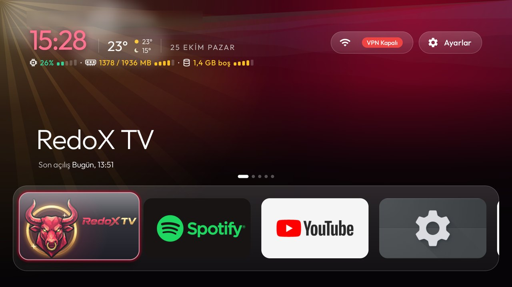
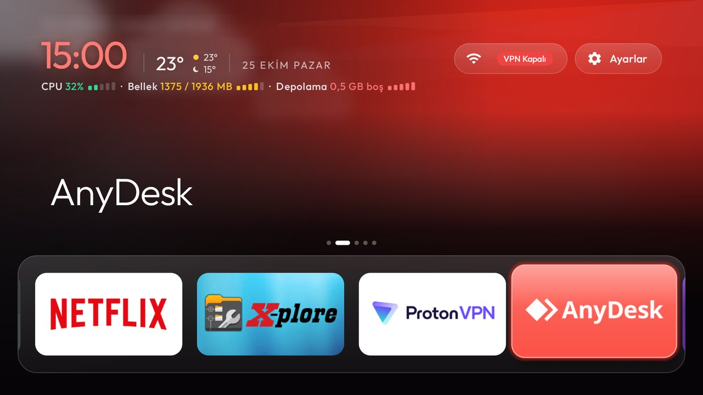
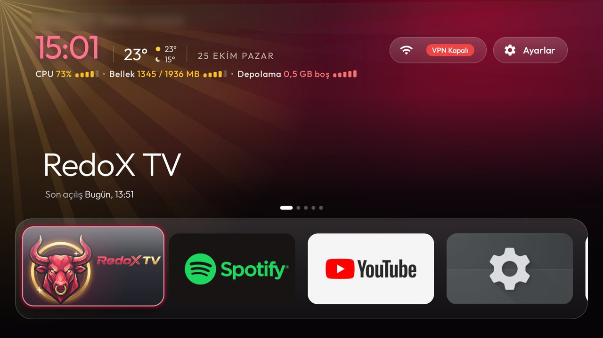
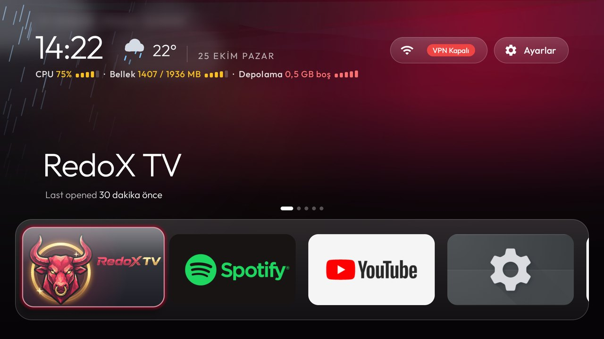
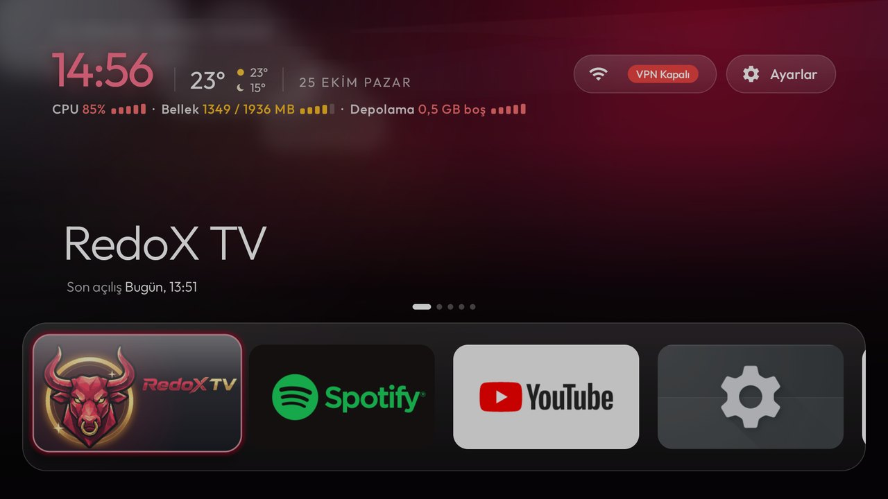
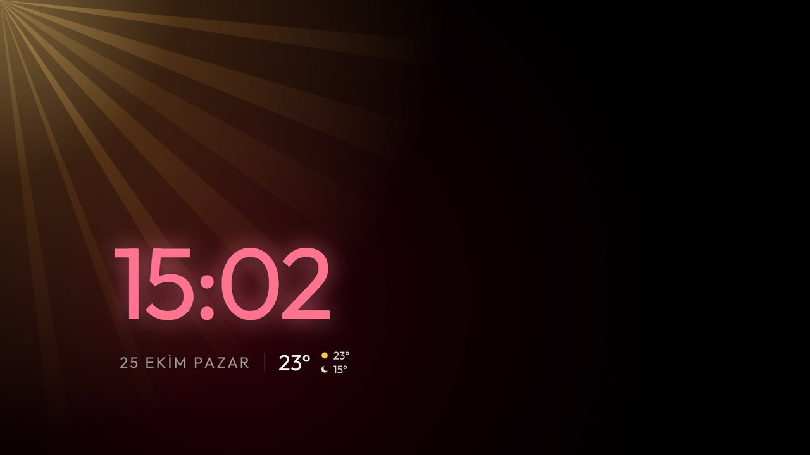

# RedoX Launcher

**English** · [Türkçe](README.tr.md)

A home screen for Android TV and Google TV, built on the launcher from
[CleanYourTV](https://github.com/Gathin23/cleanyourtv). One row of apps in a glass dock, the weather beside the
clock and in the corner of the screen, and your TV's load at a glance.



## Features

### Glass dock

Every app sits in one row inside a rounded glass frame, four tiles wide and centred at the bottom of the screen.
The tiles slide inside it a whole tile at a time, with no names under them: the app's name shows above the dock
instead. The App library button sits at the end of the row, and Left or Up takes you back to the apps.

Above the dock, up to five fixed dots show how far along the row you are.



### Clock

The clock takes the focused app's colour, kept bright so it stands out over the backdrop, with a dark shadow
under it and a soft glow in the same colour. When the minute changes, only the digits that change roll: the old
one slides up and out, the new one rises from below.

### Weather

The temperature sits beside the clock, with today's daytime high (a small sun) over tonight's low (a small moon).
The weather plays out in the top-left corner behind it: sunlight with slow rays, stars at night, drifting
clouds, rain, snow, storm flashes or fog.

| Sunny | Rain |
|---|---|
|  |  |

The data comes from [Open-Meteo](https://open-meteo.com/), with no account or key, for the `latitude` and
`longitude` you set. It updates every 30 minutes while Home is on screen. With no location set (the default),
the weather is off and nothing is fetched.

### Graded stats

CPU, memory and storage under the clock, each shown by a small icon (a chip, a memory module, a drum) and
coloured by load (green under 50%, amber from 50%, red from 80% or under 1 GB of free storage), with a
five-step meter.

### Night mode

From sunset to sunrise (worked out on the TV from your latitude and longitude, or 19:30 to 07:00 without them)
Home dims a little and the aurora and the weather move at half speed.



### Screensaver

The clock screensaver (Home left idle for `home_idle_clock_minutes`, and the system screensaver) uses the same
rolling clock, the date, the temperature and the weather in the corner. The clock follows the screensaver's
slowly changing glow, starting in the colour of the app you left focused.



### Light on the TV

The aurora and the weather scene draw about 30 frames a second, only while Home is on screen, and hold still
after two minutes without a key press; the next key starts them again. On the test TV the launcher used about
45% of one CPU core while animating and none once still.

App banners larger than a zoomed tile are kept at that size instead of the app's own (often 1280 px or more):
on the test TV that saved about 4.5 MB of native memory and 6 MB of graphics memory, with no visible change.
`shrink_banners` in `config.xml` turns it off.

### Also

- An aurora backdrop that takes the focused app's colour.
- A VPN badge in the network pill: green "VPN Açık" while a VPN is up, red "VPN Kapalı" while it is down. The
  pill opens your VPN app.

## Install

You need a computer on the same network as the TV, with JDK 17, the Android SDK (platform 34, build-tools
34.0.0) and Python 3, and ADB debugging turned on on the TV. The upstream guide explains turning on ADB and
pairing step by step: [README.cleanyourtv.md](README.cleanyourtv.md).

1. Clone this repository.
2. Edit `launcher/app/src/main/res/values/config.xml`:

   | Setting | What it does |
   |---|---|
   | `dock_apps` | The apps at the start of the row, in order (package names). |
   | `greeting_name` | A name after the greeting above the clock. |
   | `latitude`, `longitude` | Where to read the weather for, e.g. `41.01` and `28.98` for Istanbul. Empty turns the weather off. |
   | `vpn_app` | The VPN app the network pill opens, e.g. `ch.protonvpn.android`. |

3. Build and install:

   ```bash
   python3 -m venv tools/venv && tools/venv/bin/pip install -r tools/requirements.txt
   TV_HOST=<tv ip> launcher/build-and-install.sh
   ```

   On Windows run it from Git Bash. The script makes the launcher the TV's Home.

4. Press Home on the remote.

When you are done, turn ADB debugging off again: port 5555 is unencrypted.

## Good to know

- **Network access:** unlike upstream's launcher, this one has the `INTERNET` permission, used only for the
  weather. The only thing sent is the latitude and longitude you set.
- **Performance:** the aurora and the weather animate continuously. On a TV with 1 GB of RAM, expect some lag.
- **Package name:** it is still `com.gathin.tvhome`, so it installs over CleanYourTV's launcher and
  replaces it.
- **Tested on:** Chromecast with Google TV, Android 14, 1920×1080. Other TVs may lay out differently.
- **Debloating:** the debloat tools in `tools/` and the rules in `PROMPT.md` come unchanged from CleanYourTV.
  See [README.cleanyourtv.md](README.cleanyourtv.md).

## Credits and licence

Built on [CleanYourTV](https://github.com/Gathin23/cleanyourtv) by Gathin23 and its contributors. MIT licence,
as upstream: see [LICENSE](LICENSE).
